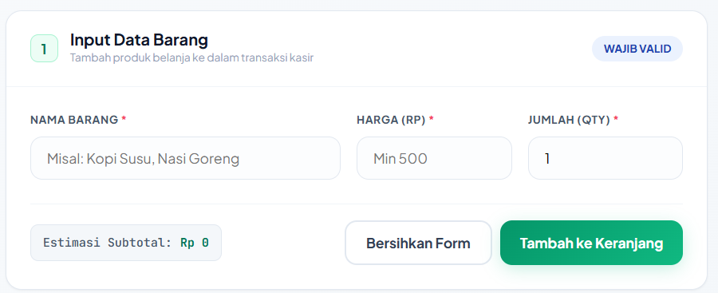
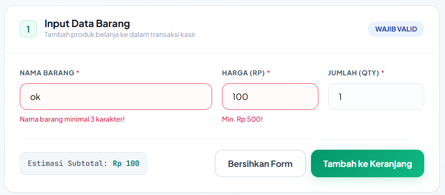
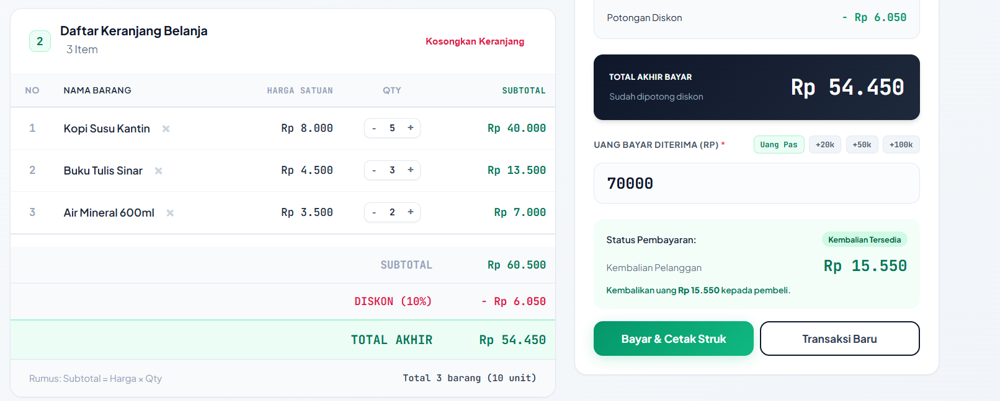

# Aplikasi Kasir & Keranjang Belanja Sederhana (Mini POS)

## Identitas

- **Nama Lengkap**: Firman Luthfiansyah
- **NIM**: 124140044
- **Kelas Praktikum**: RA
- **Mata Kuliah**: Pemrograman Aplijasi Web

---

## Deskripsi Aplikasi

**KantinKampus POS** adalah aplikasi web kasir dan keranjang belanja sederhana yang dirancang khusus untuk kasir kantin atau toko kampus. Aplikasi ini memudahkan proses transaksi penjualan dengan fitur-fitur lengkap seperti validasi input otomatis, perhitungan kalkulasi real-time, sistem diskon otomatis, dan penyimpanan data persisten menggunakan localStorage.

## Panduan Menjalankan Aplikasi

### Cara 1: Menggunakan Live Server

1. **Install Extension Live Server** di Visual Studio Code
   - Buka VS Code
   - Tekan `Ctrl+Shift+X` untuk membuka Extensions
   - Cari "Live Server" oleh Ritwick Dey
   - Klik "Install"

2. **Jalankan Aplikasi**
   - Buka folder project di VS Code
   - Klik kanan pada file `index.html`
   - Pilih "Open with Live Server"
   - Browser akan otomatis membuka aplikasi

### Cara 2: Menggunakan Browser Langsung

1. Buka folder project `FirmanLuthfiansyah_124140044_pertemuan1`
2. Double-click file `index.html`
3. Aplikasi akan terbuka di browser default Anda

---

## Daftar Fitur

### ✅ 1. Validasi Form Input Barang

- [✅] **Validasi Nama Barang**: Minimal 3 karakter, wajib diisi
- [✅] **Validasi Harga Satuan**: Minimal Rp 500, harus berupa angka positif
- [✅] **Validasi Jumlah (Qty)**: Minimal 1 unit, harus berupa angka bulat
- [✅] **Feedback Error Real-time**: Pesan error berwarna merah muncul di bawah input yang tidak valid
- [✅] **Auto-reset Form**: Form otomatis dikosongkan setelah barang berhasil ditambahkan
- [✅] **Estimasi Subtotal Real-time**: Perhitungan otomatis saat input harga/qty berubah

### ✅ 2. Kalkulator & Perhitungan Otomatis

- [✅] **Kalkulasi Subtotal per Barang**: Subtotal = Harga Satuan × Qty
- [✅] **Kalkulasi Total Belanja**: Menjumlahkan seluruh subtotal barang
- [✅] **Diskon Otomatis 10%**: Aktif jika total belanja ≥ Rp 50.000
- [✅] **Kode Promo "HEMAT10"**: Input kode voucher untuk mendapat diskon
- [✅] **Kalkulator Kembalian**: Kembalian = Uang Bayar − Total Akhir
- [✅] **Warning Uang Kurang**: Notifikasi merah jika uang bayar tidak mencukupi
- [✅] **Shortcut Pembayaran**: Tombol +20k, +50k, +100k untuk mempercepat input

### ✅ 3. Manajemen Keranjang Belanja & LocalStorage

- [✅] **Tabel Keranjang Belanja**: Menampilkan No, Nama Barang, Harga, Qty, Subtotal, dan Aksi
- [✅] **Aksi Hapus Item**: Tombol hapus untuk menghapus barang dari keranjang
- [✅] **Update Otomatis**: Total dan diskon langsung terhitung ulang setelah perubahan
- [✅] **LocalStorage Persisten**: Menggunakan `JSON.stringify()` dan `JSON.parse()`
- [✅] **Auto-save**: Data tersimpan otomatis setiap kali ada perubahan
- [✅] **Auto-load**: Data dimuat kembali saat halaman di-refresh
- [✅] **Kosongkan Keranjang**: Tombol untuk menghapus semua item sekaligus
- [✅] **Transaksi Baru**: Reset seluruh keranjang dan mulai transaksi baru

---

##  Tangkapan Layar (Screenshot)

### 1. Tampilan Form Input Utama


### 2. Tampilan Validasi Error


### 3. Tampilan Tabel Keranjang & Pembayaran

---

## Penjelasan Teknis

### 1. Validasi Input Form (script.js)

```javascript
function validateForm() {
    let isValid = true;
    
    // Validasi Nama Barang (minimal 3 karakter)
    const namaBarang = document.getElementById('nama-barang').value.trim();
    if (namaBarang.length < 3) {
        showError('error-nama', 'Nama barang minimal 3 karakter');
        isValid = false;
    }
    
    // Validasi Harga (minimal 500)
    const harga = parseInt(hargaBarang);
    if (!hargaBarang || isNaN(harga) || harga < 500) {
        showError('error-harga', 'Harga minimal Rp 500');
        isValid = false;
    }
    
    // Validasi Jumlah (minimal 1)
    const jumlah = parseInt(jumlahBarang);
    if (!jumlahBarang || isNaN(jumlah) || jumlah < 1) {
        showError('error-jumlah', 'Jumlah minimal 1 unit');
        isValid = false;
    }
    
    return isValid;
}
```

**Penjelasan**: 
- Fungsi `validateForm()` memeriksa setiap input sebelum data ditambahkan ke keranjang
- Menggunakan `.trim()` untuk menghilangkan spasi di awal/akhir
- Validasi harga dan qty menggunakan `parseInt()` dan `isNaN()` untuk memastikan input berupa angka
- Fungsi `showError()` menampilkan pesan error dengan class CSS `.show`

---

### 2. Algoritma Kalkulator Keuangan

```javascript
function updatePembayaran() {
    // Hitung total belanja (sum semua subtotal)
    const totalBelanja = keranjang.reduce((sum, item) => sum + item.subtotal, 0);
    
    // Logika diskon otomatis
    let diskonAmount = 0;
    const kodePromo = document.getElementById('kode-promo').value.trim().toUpperCase();
    
    if (totalBelanja >= MINIMAL_BELANJA_DISKON || kodePromo === KODE_PROMO_VALID) {
        diskonAmount = totalBelanja * (DISKON_PERSEN / 100);
    }
    
    // Total akhir setelah diskon
    const totalAkhir = totalBelanja - diskonAmount;
    
    // Kalkulasi kembalian
    const uangBayar = parseInt(document.getElementById('uang-bayar').value) || 0;
    const kembalian = uangBayar - totalAkhir;
}
```

**Penjelasan**:
- **Array.reduce()**: Digunakan untuk menjumlahkan semua subtotal item dalam keranjang
- **Logika Diskon**: Cek apakah total ≥ Rp 50.000 ATAU kode promo valid (HEMAT10)
- **Perhitungan Diskon**: `diskonAmount = totalBelanja × 10%`
- **Total Akhir**: `totalBelanja - diskonAmount`
- **Kembalian**: `uangBayar - totalAkhir`
- Semua perhitungan update secara real-time saat ada perubahan

---

### 3. Mekanisme Serialisasi LocalStorage

```javascript
// SAVE: Menyimpan keranjang ke localStorage
function saveToLocalStorage() {
    try {
        const data = JSON.stringify(keranjang);
        localStorage.setItem('keranjangPOS', data);
        console.log('✓ Data berhasil disimpan');
    } catch (error) {
        console.error('Error saving:', error);
    }
}

// LOAD: Memuat keranjang dari localStorage
function loadFromLocalStorage() {
    try {
        const data = localStorage.getItem('keranjangPOS');
        if (data) {
            keranjang = JSON.parse(data);
            console.log('✓ Data berhasil dimuat');
        }
    } catch (error) {
        console.error('Error loading:', error);
        keranjang = [];
    }
}
```

**Penjelasan**:
- **JSON.stringify()**: Mengubah array JavaScript `keranjang` menjadi string JSON untuk disimpan
- **localStorage.setItem()**: Menyimpan string JSON dengan key `'keranjangPOS'`
- **localStorage.getItem()**: Mengambil string JSON dari localStorage
- **JSON.parse()**: Mengubah string JSON kembali menjadi array JavaScript
- **Try-Catch**: Error handling untuk menangani kegagalan akses localStorage
- **Auto-save**: Fungsi `saveToLocalStorage()` dipanggil setiap kali ada perubahan data
- **Auto-load**: Fungsi `loadFromLocalStorage()` dipanggil saat halaman pertama kali dimuat (`DOMContentLoaded`)

---

