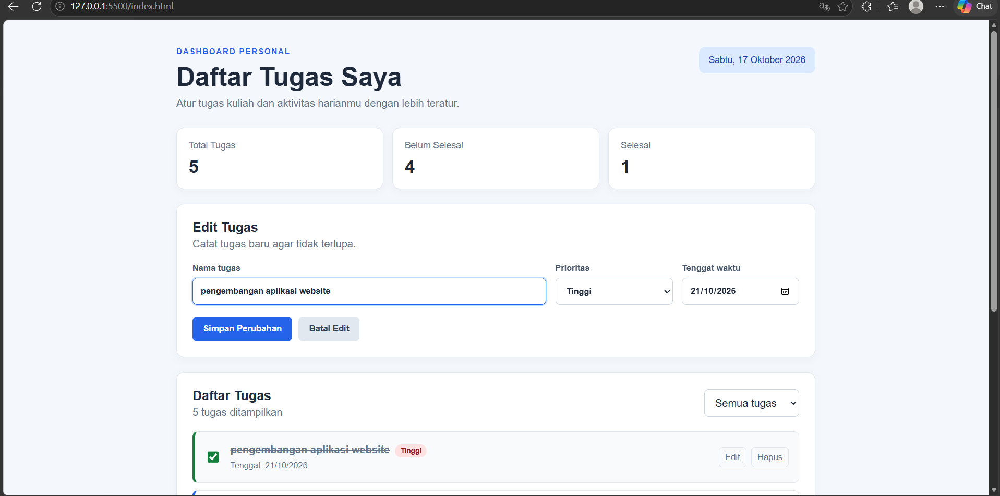
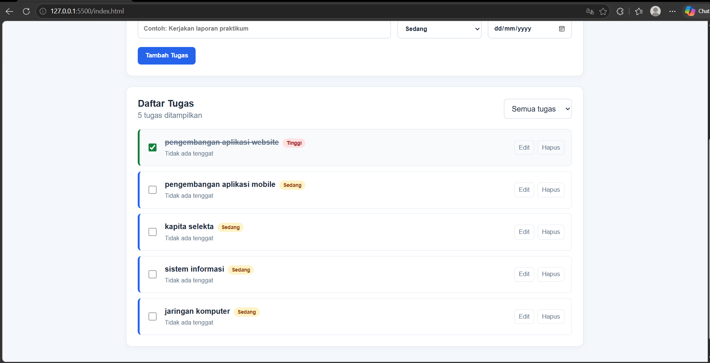
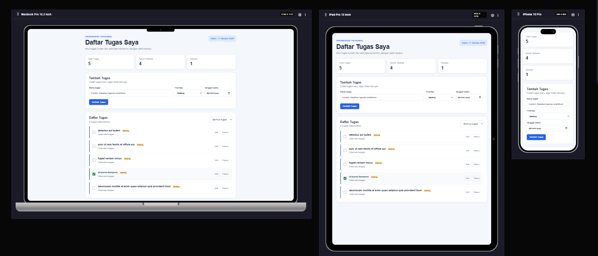

# Dashboard Personal Daftar Tugas

## Identitas

- **Nama Lengkap:** Firman Luthfiansyah
- **NIM:** 124140044
- **Kelas Praktikum:** Pemrograman aplikasi Web

## Deskripsi Aplikasi

Aplikasi ini merupakan dashboard personal sederhana untuk mencatat dan mengelola daftar tugas kuliah maupun aktivitas harian. Studi kasus yang dipilih adalah **manajemen tugas pribadi**.

Tujuan pembuatan aplikasi ini adalah membantu pengguna melihat ringkasan tugas, menambahkan tugas baru, menentukan prioritas dan tenggat waktu, serta memantau tugas yang sudah selesai dalam satu halaman.

## Panduan Menjalankan Aplikasi

### Menggunakan Live Server di VS Code

1. Buka folder proyek di Visual Studio Code.
2. Pastikan ekstensi **Live Server** sudah terpasang.
3. Buka file `index.html`.
4. Klik kanan pada file tersebut, kemudian pilih **Open with Live Server**.
5. Aplikasi akan terbuka pada browser melalui alamat lokal, biasanya `http://127.0.0.1:5500`.

### Membuka secara langsung

File `index.html` juga dapat dibuka langsung dengan browser. Namun, Live Server lebih disarankan agar proses pengembangan dan pemuatan file berjalan lebih stabil.

## Daftar Fitur

- [x] Menampilkan tanggal hari ini.
- [x] Menampilkan ringkasan jumlah seluruh tugas.
- [x] Menampilkan jumlah tugas yang belum selesai.
- [x] Menampilkan jumlah tugas yang sudah selesai.
- [x] Menambahkan tugas baru.
- [x] Mengatur prioritas tugas: rendah, sedang, dan tinggi.
- [x] Menambahkan tenggat waktu tugas.
- [x] Mengedit tugas yang sudah dibuat.
- [x] Menghapus tugas.
- [x] Menandai tugas sebagai selesai menggunakan checkbox.
- [x] Memfilter tugas berdasarkan status.
- [x] Menyimpan data tugas menggunakan `localStorage`.
- [x] Mengambil data awal dari API JSONPlaceholder menggunakan `fetch`.
- [x] Menyediakan data cadangan apabila API tidak dapat diakses.
- [x] Menggunakan desain responsif untuk layar desktop dan perangkat mobile.
- [x] Menggunakan class `ItemTugas` dan `AplikasiDashboard`.
- [x] Menggunakan fitur ES6+, seperti `let`, `const`, arrow function, destructuring, spread operator, dan template literals.
- [x] Menggunakan fungsi asynchronous dengan `async/await`.

## Tangkapan Layar

### 1. Tampilan Dashboard dan Ringkasan Tugas



### 2. Formulir dan Daftar Tugas



### 3. Tampilan Fitur Pengelolaan Tugas



## Penjelasan Teknis Singkat

### Alur utama JavaScript

1. Class `AplikasiDashboard` dibuat untuk mengelola state aplikasi, event pengguna, proses rendering, dan penyimpanan data.
2. Class `ItemTugas` digunakan sebagai model untuk setiap data tugas. Setiap objek tugas memiliki `id`, `title`, `priority`, `dueDate`, dan `completed`.
3. Saat aplikasi dimulai, method `init()` memasang event listener, menampilkan tanggal, lalu memeriksa data pada `localStorage`.
4. Jika `localStorage` belum memiliki data, aplikasi mengambil lima data awal dari JSONPlaceholder menggunakan `fetch` dan `async/await`.
5. Data kemudian ditampilkan ke halaman menggunakan template literals pada method `taskTemplate()`.

### Validasi input

- Input nama tugas menggunakan atribut HTML `required`, sehingga tidak boleh dikosongkan.
- Nilai nama tugas diproses menggunakan `.trim()` untuk menghapus spasi yang tidak diperlukan di awal dan akhir teks.
- Prioritas dipilih melalui elemen `select`, sehingga pengguna hanya dapat memilih nilai yang tersedia.
- Tenggat waktu menggunakan input bertipe `date` agar format tanggal mengikuti format yang valid.

### Algoritma pengelolaan data

- Penambahan tugas dilakukan dengan membuat objek `ItemTugas` baru, lalu menambahkannya ke awal array tugas menggunakan spread operator.
- Pengeditan tugas dilakukan menggunakan `map()`. Tugas dengan `id` yang sesuai akan diganti dengan objek baru, sedangkan tugas lain tetap dipertahankan.
- Penghapusan tugas dilakukan menggunakan `filter()` untuk membuat array baru tanpa tugas yang dipilih.
- Perubahan status selesai juga menggunakan `map()` dan membalik nilai `completed` dari `false` menjadi `true`, atau sebaliknya.
- Filter daftar tugas menggunakan `filter()` berdasarkan pilihan `semua`, `belum`, atau `selesai`.

### Mekanisme serialisasi `localStorage`

Data tugas disimpan pada browser menggunakan kode berikut:

```javascript
localStorage.setItem(
  this.storageKey,
  JSON.stringify(this.tasks)
);
```

Karena `localStorage` hanya menyimpan data dalam bentuk string, array objek tugas diubah menjadi string JSON menggunakan `JSON.stringify()`. Ketika aplikasi dibuka kembali, string tersebut diambil dan dikembalikan menjadi array JavaScript menggunakan `JSON.parse()`:

```javascript
const savedTasks = localStorage.getItem(this.storageKey);
this.tasks = JSON.parse(savedTasks).map((task) => new ItemTugas(task));
```

Dengan mekanisme ini, data tugas tetap tersedia setelah halaman browser dimuat ulang selama data pada `localStorage` belum dihapus.

## Struktur File

```text
.
├── index.html
├── style.css
├── script.js
├── README.md
└── dokumentasi
    ├── dokumentasi-1.png
    ├── dokumentasi-2.png
    └── dokumentasi-3.png
```
