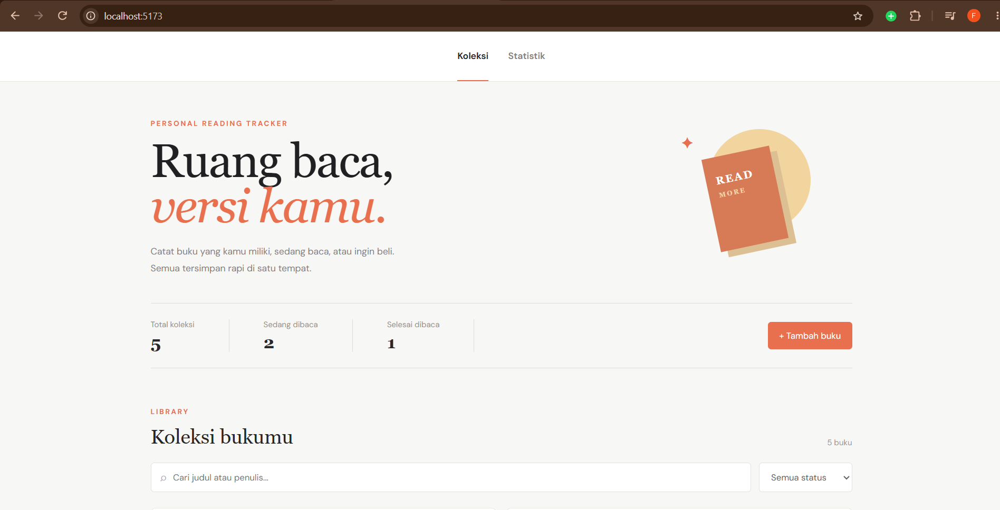
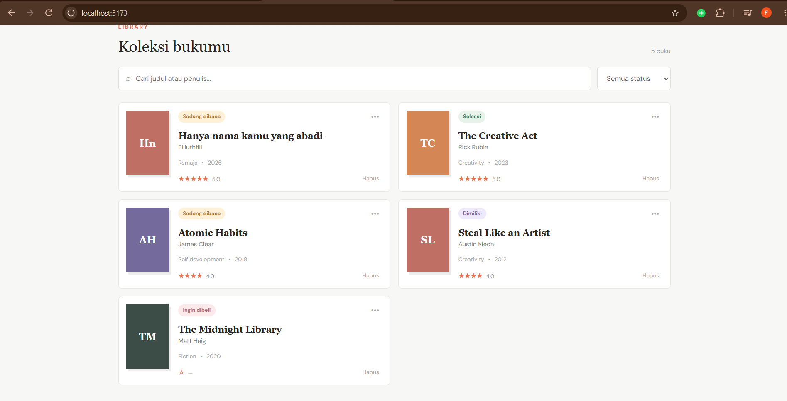
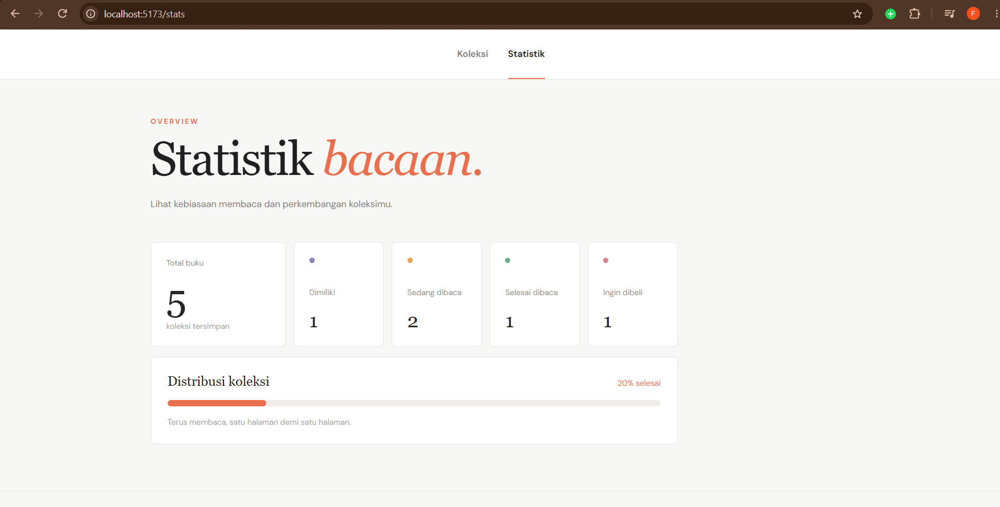
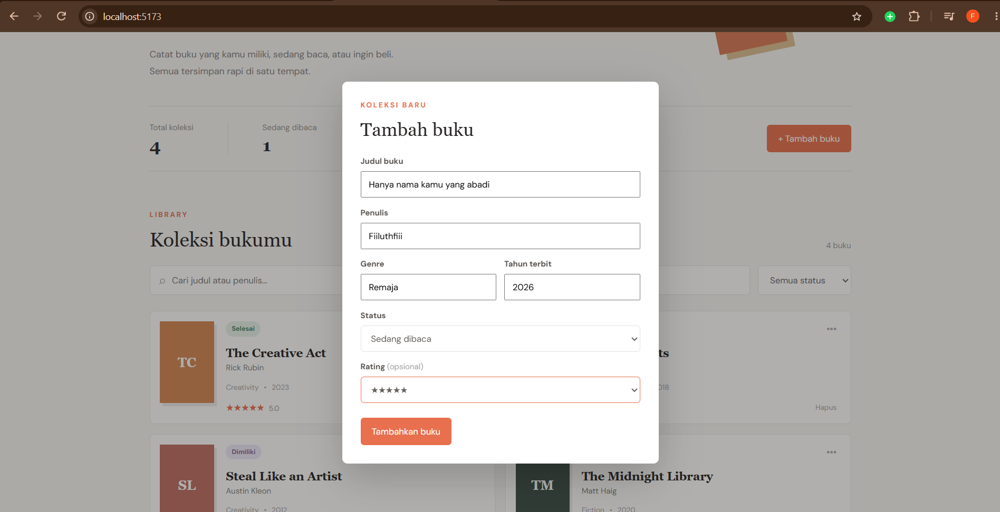
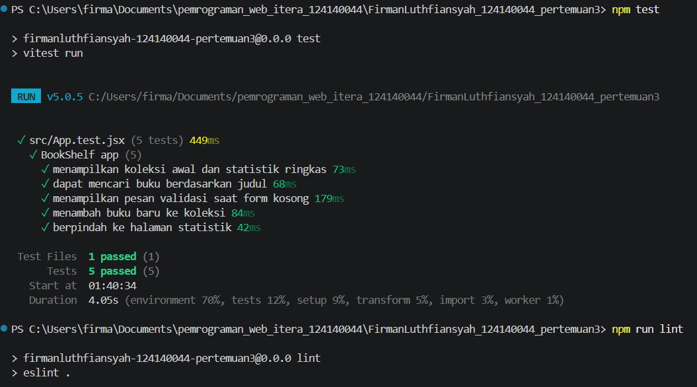

## Deskripsi Aplikasi

- **Koleksi**: menampilkan seluruh buku, pencarian, filter status, serta fitur tambah, edit, dan hapus buku.
- **Statistik**: menampilkan jumlah total buku, jumlah buku berdasarkan status, dan persentase buku yang sudah selesai dibaca.

## Fitur Utama

- Menambahkan buku baru dengan judul, penulis, genre, tahun terbit, status, dan rating.
- Mengedit data buku.
- Menghapus buku dari koleksi.
- Mencari buku berdasarkan judul atau nama penulis.
- Memfilter buku berdasarkan status.
- Menyimpan data secara persisten dengan `localStorage`.
- Validasi input wajib pada form buku.
- Navigasi multi-halaman menggunakan React Router.
- Tampilan responsif untuk desktop dan perangkat mobile.

## Struktur Folder

```text
src/
├── components/
│   ├── BookFilter/
│   ├── BookForm/
│   └── BookList/
├── context/
│   └── BookContext.jsx
├── hooks/
│   ├── useBookStats.js
│   └── useLocalStorage.js
├── pages/
│   ├── Home/
│   └── Stats/
├── App.jsx
├── App.css
├── App.test.jsx
├── index.css
└── main.jsx
```

## Instalasi dan Menjalankan Aplikasi

Pastikan Node.js dan npm sudah terpasang, kemudian jalankan:

```bash
npm install
npm run dev
```

Buka alamat localhost yang ditampilkan oleh Vite pada terminal, biasanya:

```text
http://localhost:5173
```

Untuk membuat production build:

```bash
npm run build
npm run preview
```

## Testing dan Linting

Menjalankan unit test:

```bash
npm test
```

Menjalankan linting:

```bash
npm run lint
```

Unit test mencakup:

1. Menampilkan koleksi buku awal.
2. Pencarian buku berdasarkan judul.
3. Validasi ketika form kosong.
4. Penambahan buku baru.
5. Navigasi ke halaman Statistik.

Hasil pengujian terakhir: **5 test berhasil**.


## Dokumentasi Screenshot

Screenshot antarmuka aplikasi tersedia di folder [`public/dokumentasi`](public/dokumentasi):

### Halaman Koleksi



### Daftar Buku dan Filter



### Halaman Statistik



### Form Tambah Buku



## Catatan Kode

Bagian penting aplikasi telah dipisahkan berdasarkan tanggung jawabnya:

- `BookContext.jsx` mengatur state global dan operasi CRUD.
- `useLocalStorage.js` mengatur penyimpanan data ke browser.
- `useBookStats.js` menghitung ringkasan statistik buku.
- `BookForm.jsx`, `BookFilter.jsx`, dan `BookList.jsx` merupakan komponen reusable.
- `Home.jsx` mengatur halaman koleksi.
- `Stats.jsx` mengatur halaman statistik.


### Screenshot Laporan Testing

Berikut adalah tangkapan layar hasil eksekusi unit test pada terminal:

